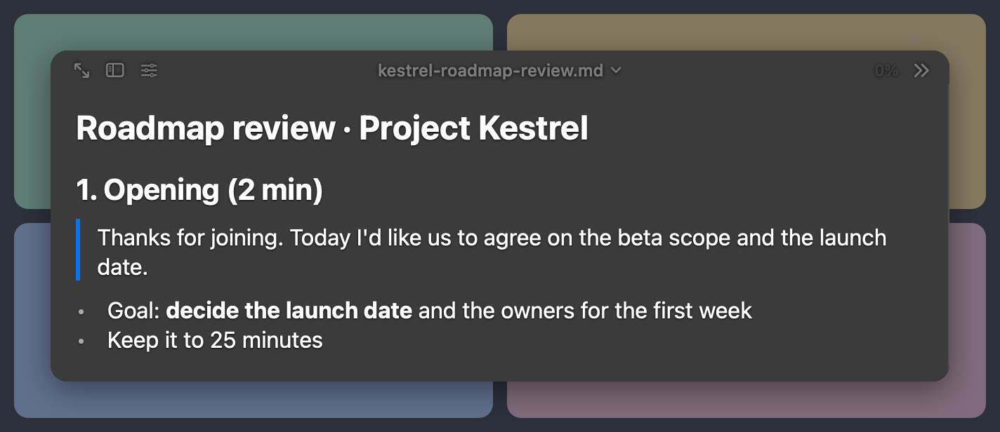
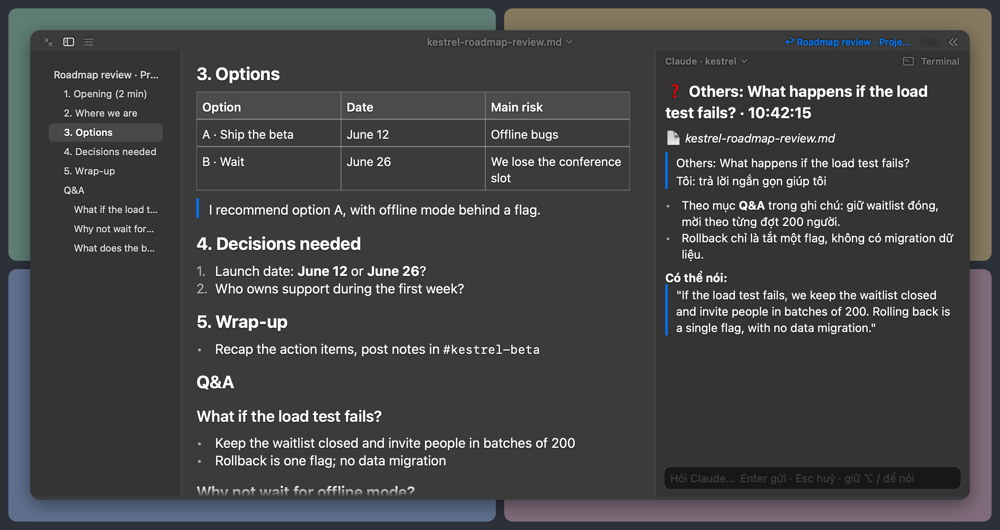
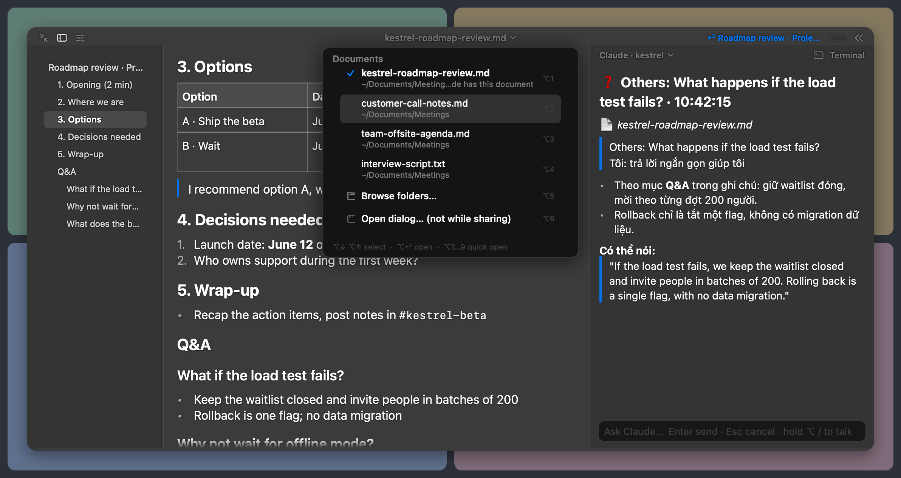
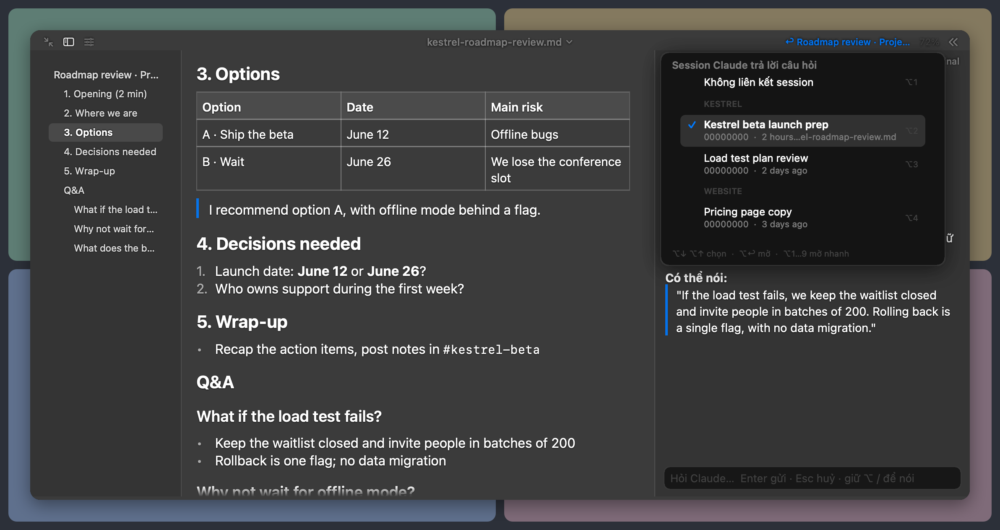

# TalkMargin

A private teleprompter for meetings and presentations: your notes in the margin beside the conversation.

TalkMargin is a macOS menu-bar app. It shows your Markdown or Word (`.docx`) notes in an overlay that stays above every window, including full-screen meeting apps and every Space. The overlay never takes keyboard focus from the meeting app, and it is excluded from screen capture, within the limits listed under [Known limitations](#known-limitations). You drive it with right-Option shortcuts. An optional Claude side chat answers questions from a read-only fork of a Claude Code session you prepared.

It is for people who talk from prepared notes on calls: presenters, interviewers and interviewees, support and sales engineers, anyone doing a knowledge transfer.

> **Language:** the interface is in English and Vietnamese. Switch it with **Language** (**VI | EN**) in the display settings (the slider button in the overlay header); the change applies at once and is remembered. A new install starts in Vietnamese when macOS prefers Vietnamese over English, otherwise in English; an install that was already in use stays in Vietnamese. Your notes and saved conversations are never translated: a saved question, answer or error message stays in the language it was written in. This README uses the English names. Claude's answers do not follow this setting: Claude is told to explain in Vietnamese and to write the lines you might say in English (see [docs/claude.md](docs/claude.md)).





*Screenshots: synthetic notes ([examples/demo-meeting.md](examples/demo-meeting.md)) and a synthetic chat. The app's own views were rendered offscreen by [docs/images/src/render.sh](docs/images/src/render.sh) and composited over a mock call.*

## Requirements

| | |
|---|---|
| macOS | 26 or later (`LSMinimumSystemVersion` 26.0; uses the macOS 26 `SpeechAnalyzer` API) |
| Hardware | Apple silicon. Builds are arm64 only. Intel Macs are not built or tested. |
| Tested on | macOS 26.6.2, Apple silicon |
| Build from source | Xcode with the macOS 26 SDK and Swift 6.2 or later (`swift-tools-version: 6.2`). Tested with Xcode 27.1 / Swift 6.4; the minimum Xcode version is unknown. |
| Claude chat (optional) | The [Claude Code](https://docs.anthropic.com/en/docs/claude-code) CLI (`claude`), installed and logged in, an account or plan that covers its use, and network access. Minimum CLI version: unknown. |
| Push-to-talk (optional) | On-device speech models for English (US) and Vietnamese. macOS downloads them on first use, which needs network access once. |

## Install

There are two ways: a release disk image, or a build from source. Both install to `~/Applications/TalkMargin.app`. Installing there needs no admin rights.

### From a release

Releases are on `https://github.com/clongnguyen6/talkmargin/releases`. Each one has a `.dmg` and a `.sha256`.

The app is signed with an **Apple Development** certificate. It is **not notarized** and has no Developer ID. A dmg downloaded with a browser carries the quarantine flag. `gh release download` and `curl -LO` do not add it.

- **What macOS blocks:** from a quarantined dmg, Gatekeeper refuses a double-clicked `Install.command`, and an app run from the disk image.
- **What it does not block:** the copy that `update.sh` installs into `~/Applications` carries no quarantine flag. This was shown in a sandbox simulation. That such a copy then launches without a prompt is expected but not verified on a second Mac.
- **Two ways past the refusal:**
  - **System Settings → Privacy & Security → Open Anyway.** This asks for an administrator password (Apple's documented behaviour since macOS 15).
  - **Without admin rights:** run the installer from Terminal with `sh /Volumes/TalkMargin/Install.command`. A script run this way is not assessed by Gatekeeper.

[docs/release.md](docs/release.md) has the evidence. The dialogs themselves were not observed.

1. Check the download: `shasum -a 256 -c TalkMargin-<version>.dmg.sha256`, in the folder that holds both files.
2. Quit TalkMargin if it runs.
3. Open the dmg and double-click **Install.command**, or run `sh /Volumes/TalkMargin/Install.command`. It runs `update.sh` on the app beside it. From a checkout, `scripts/update.sh <file.dmg>` does the same.
4. Eject the dmg. Do not run the app from the disk image.

### From source

```sh
git clone https://github.com/clongnguyen6/talkmargin.git
cd talkmargin
swift test                         # unit tests
./scripts/build-app.sh --install   # build, sign, install ~/Applications/TalkMargin.app
```

`build-app.sh` signs with your first Apple Development identity, or with the identity in `MP_SIGN_IDENTITY`. Without one it signs ad-hoc and warns you. Ad-hoc builds lose their permission grants on every rebuild. See [CONTRIBUTING.md](CONTRIBUTING.md) for dev builds.

**Your own signing identity and bundle id.** Anyone can build with their own certificate; `MP_SIGN_IDENTITY` selects it. A fork that ships its own builds should also change the bundle id `com.long.meetingprompter`, so its copies never collide with this project's builds in LaunchServices, settings or permissions. The id is hard-coded in several places, listed in [CONTRIBUTING.md](CONTRIBUTING.md#bundle-id).

## First run and permissions

TalkMargin has a menu-bar icon and no Dock icon. On first launch it shows a help page in the overlay and asks for Accessibility.

| Permission | What it is for | When it is asked |
|---|---|---|
| Accessibility | The right-Option shortcuts. A keyboard event tap reads key events to find right-Option combinations, and consumes only those. Nothing is logged or stored. | First launch. Until you grant it, the menu's first item is **Grant Accessibility to enable shortcuts…**. Shortcuts start working within a second of the grant. |
| Screen & System Audio Recording | Push-to-talk only: the meeting's sound (system audio). The capture API also requires a video stream, which is set to 2 × 2 pixels at 1 frame per second and never used. | The first time you hold `⌥ /` |
| Microphone | Push-to-talk only: your voice. If you refuse, only the meeting audio is recognized. | The first time you hold `⌥ /` |

The app never requests a separate Speech Recognition permission. Whether macOS asks for one on some setups is untested. Reading notes needs no permission; without Accessibility you can still scroll and click in the overlay.

**Open at login** in the menu turns launch at login on or off. It is listed under System Settings → General → Login Items.

## Quick start

1. Click the menu-bar icon → **Open file…** and pick a `.md`, `.markdown`, `.txt` or `.docx` file. You can also run `open -a TalkMargin notes.md`, or use Open With in Finder. Try [examples/demo-meeting.md](examples/demo-meeting.md).
2. Press right-Option + `P` (`⌥P`) to show or hide the overlay. Drag its header to move it, and drag an edge to resize it. **Move next to webcam** puts it at the top center of the screen that has the camera, so your eyes stay near the lens.
3. Scroll with `⌥↓` / `⌥↑`, jump between sections with `⌥]` / `⌥[` or `⌥1` … `⌥9`, and press `⌥E` for the expanded view.
4. Edit the file in any editor. The overlay reloads on save. TalkMargin only reads your notes; it never writes to them.

Writing tips: one `##` heading per part of the talk, so the outline and the section jumps follow your structure. Put lines to say verbatim in quotes (`>`); they get an accent bar. Put prepared answers under `## Q&A`, with one `### Question?` heading each. Tables render as tables. Word documents keep their headings, lists, emphasis, quotes and tables; images, footnotes, text boxes and link targets are dropped.

## Switching documents



Click the file name in the header, or press `⌥D`. A list drops down inside the overlay:

- **recent files** (`⌥1` … `⌥9` opens row N);
- **Browse folders…**: a folder browser drawn inside the overlay, safe while you share your screen;
- **Open dialog… (not while sharing)**: the macOS open dialog. Its menus are drawn by macOS and are visible to screen sharing, so use it only when you are not sharing.

The overlay remembers the reading position of each file, and a separate position and size for the compact and expanded views. Opening a document while TalkMargin runs, from Finder, Open With, `open` or by dragging it onto the icon, sends it to the running overlay. Only one TalkMargin runs per user.

## Shortcuts

All shortcuts use the **right Option key** (`⌥` below). Left Option keeps working normally in other apps.

| Shortcut | Action |
|---|---|
| `⌥P` | Show / hide the overlay |
| `⌥↓` / `⌥↑` | Scroll by lines; hold to scroll continuously |
| `⌥]` / `⌥[` | Next / previous heading |
| `⌥1` … `⌥9` | Jump to section N |
| `⌥O` | Show / hide the outline; click a heading to jump |
| `⌥←` / `⌥→` | Back to where you were before a jump (also the `↩` header button) / forward again |
| `⌥E` | Expanded / compact (also the corner button, or double-click the header) |
| `⌥=` / `⌥-` | Larger / smaller text |
| `⌥T` | Click-through: clicks pass through the overlay to the app behind |
| `⌥D` | Switch document |
| `⌥A` | Open / close the Claude column (also the `>>` button) |
| `⌥K` | Type a question for Claude: Enter sends, Shift+Enter adds a line, Esc cancels |
| `⌥S` | Choose the Claude session |
| Hold `⌥ /` | Push-to-talk: record the meeting audio and your microphone; release to review the text, then press Enter. Hold again to add more. |
| In a list | `⌥↓` / `⌥↑` move, `⌥↩` choose, `⌥1` … `⌥9` choose row N; `⌥D`, `⌥S` or a click elsewhere closes it |

**Display:** the slider button in the header, or the menu's **Display settings…**, opens live controls. **Backdrop** sets the backdrop darkness. **Blur apps behind** blurs the apps behind; turn it off to see through, for example to watch the screen you are sharing (combine with `⌥T`). **Text band** draws a subtitle-style band behind the text. **Text opacity** sets text opacity and **Font size** the font size. **Language** switches the interface between Vietnamese (**VI**) and English (**EN**). **Defaults** resets the display settings; it leaves the language as it is.

**Copy:** selecting text in the notes or the chat copies it as plain text at once, with no `⌘C` and no focus change.

## Linking a Claude session



Claude is optional. Everything above works without it. To use it:

1. In a terminal, start a Claude Code session in your project and prepare it: point it at the code, documents and context you may be asked about.
2. In TalkMargin, press `⌥A` to open the Claude column, then click its title (or press `⌥S`). The list shows your recent Claude Code sessions by project. Pick the one you prepared.
3. Ask with `⌥K`, or hold `⌥ /` to capture what was just said. The first question forks the session: your original session is never changed. Claude can only read and search files (Read, Grep, Glob). Answers stream into the column.
4. The **Terminal** button copies a `cd … && claude --resume <fork>` command and brings Ghostty (or Terminal) forward, so you can continue the conversation there.

Conversations are saved and the latest one is restored at launch. The menu's **New conversation** starts a new conversation and **Past conversations** reopens an older one. What is sent, where it goes and what is stored: [docs/claude.md](docs/claude.md).

## Upgrading

Quit TalkMargin first (menu → **Quit**). The installer refuses to run while any copy of the app is running, and changes nothing in that case.

- **Release:** run `Install.command` from the new dmg, or `scripts/update.sh <file.dmg>`.
- **Source:** `git pull`, then `./scripts/build-app.sh --install`.

Settings, conversations and reading positions stay as they are; they are keyed to the bundle id. The Accessibility grant survives an update only when the new build is signed with the same identity. `update.sh` refuses a build signed by a different identity unless you pass `--allow-identity-change`, and refuses an older build unless you pass `--allow-downgrade`. [docs/distribution.md](docs/distribution.md) documents every check.

## Known limitations

**Screen sharing.** The overlay sets `NSWindow.sharingType = .none`. Production builds always exclude it from capture. Dev and verification builds can opt in to being captured with `MP_ALLOW_CAPTURE=1`, for screenshots while testing; a red **CAPTURE ALLOWED** (**ĐANG CHO CHỤP MÀN HÌNH**) label in the header then shows it. What has been verified, and what has not:

- Verified on macOS 26.6.2: the overlay is absent from ScreenCaptureKit captures and from the window list.
- One user test with Microsoft Teams, as seen by a second account on the receiving end: the overlay was not visible, in both whole-screen and single-window sharing. Only the reading overlay was on screen; the pickers, the question box, the chat and the display settings were not tested by a receiver.
- The legacy `CGDisplayStream` API **does** capture the overlay. A sharing or recording app that uses it shows your notes.
- Visible to a whole-screen share by design: the menu-bar menu, and the menus inside the macOS open dialog. Use the in-overlay folder browser while sharing.
- Zoom, Google Meet and other apps are untested. Check with a test call before you rely on it.

**Other limits**

- Saving from Microsoft Word while a `.docx` is open was not tested; reload was tested with files replaced by a script.
- Push-to-talk recognizes meeting audio as English, and your microphone as English and Vietnamese. It was not tested with real speech in Vietnamese. Without headphones, your microphone also picks up the meeting; that echo is dropped.
- The interface language setting covers TalkMargin's own text. Text drawn by macOS follows the macOS language instead: the open dialog, permission prompts, the menu's shortcut symbols and error details from the system. The microphone permission prompt shows TalkMargin's purpose in both languages.
- Apple silicon and macOS 26 only. The app is not notarized.
- One TalkMargin per user account.

## Privacy

Your notes stay on your Mac unless you use the Claude chat. Speech recognition runs on-device. [docs/privacy.md](docs/privacy.md) lists what each permission is for and where data lives. To report a security issue, see [SECURITY.md](SECURITY.md).

## Documentation

- [docs/claude.md](docs/claude.md): the Claude chat: requirements, data flow, storage.
- [docs/privacy.md](docs/privacy.md): capture exclusion, permissions, data locations.
- [docs/architecture.md](docs/architecture.md): components and data flow.
- [docs/distribution.md](docs/distribution.md): versions, dmg, `update.sh`, signing.
- [docs/e2e-testing.md](docs/e2e-testing.md): testing on your own Mac.
- [CONTRIBUTING.md](CONTRIBUTING.md): build, test, conventions, releases.
- [CHANGELOG.md](CHANGELOG.md).

## Icon

The icon artwork was generated with OpenAI image generation (per the C2PA manifest embedded in the generated source image: ChatGPT, gpt-image; the manifest's signature was not validated). It was made from the prompts in [design/icon-concepts/prompts.json](design/icon-concepts/prompts.json), which are verbatim and use the app's former name, Meeting Prompter. It was then mechanically fitted to the macOS icon grid by the scripts in [design/final/src](design/final/src). The generated source images and the prompts are in the repository.

## License

MIT; see [LICENSE](LICENSE). The license covers the files as distributed in this repository, including the icon assets, to the extent the contributors hold rights in them. AI-generated artwork may not be protected by copyright. SF Symbols shown in screenshots are Apple's.
